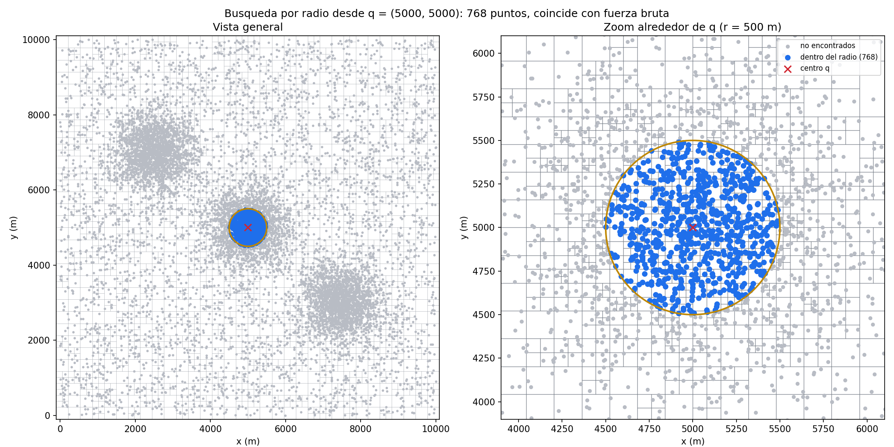
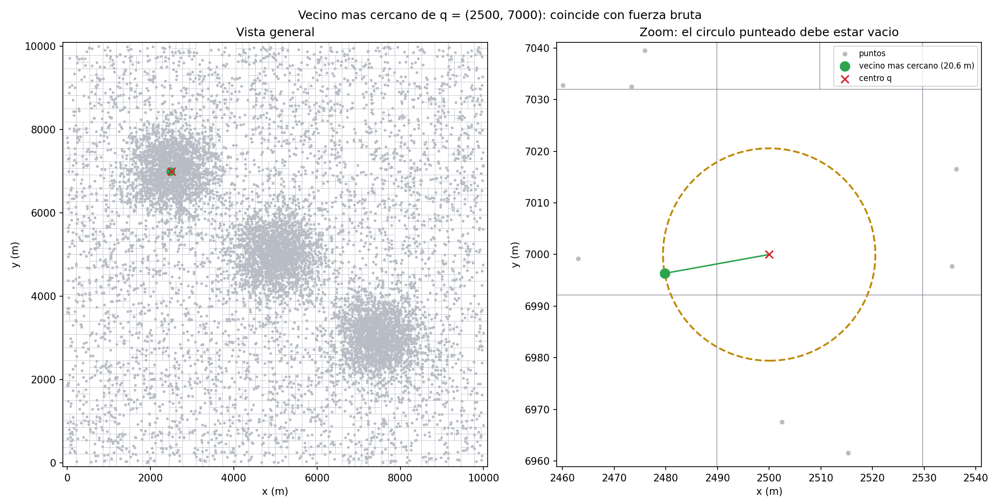

# Laboratorio 4 – Quadtree vs. fuerza bruta

**Estructura de Datos y Laboratorio** · Universidad de Antioquia
**Autor:** Juan David Puerta Palacio

Implementación **desde cero** de un Quadtree 2D para responder, sobre 10.000 puntos de entrega en una ciudad:

1. ¿Qué puntos están a 500 m de un punto dado? (*range search*)
2. ¿Cuál es el punto de entrega más cercano a una ubicación dada? (*nearest neighbour*)

y compararlo con fuerza bruta (recorrer la lista completa).

## Contenido del repositorio

| Archivo | Qué contiene |
|---|---|
| `Quadtreetree.py` | Clases `Nodo` y `Quadtree`, más `buscar_radio_bruta` y `vecino_bruto` (referencia). Sin librerías externas. |
| `test.py` | 31 pruebas unitarias (`unittest`), visualizaciones y resumen del análisis de pruebas. |
| `analisis.py` | Métricas de rendimiento, gráficas y discusión de resultados. |
| `figuras/` | Gráficas generadas por `test.py` (`fig_*.png`) y `analisis.py` (`an_*.png`). |
| `resultados.csv`, `entorno.txt`, `discusion.txt` | Salidas de `analisis.py`. |

## Cómo ejecutar

Requiere Python 3 y matplotlib (`pip install matplotlib`). Solo `test.py` y `analisis.py` usan matplotlib; el árbol no usa nada externo.

```bash
python test.py        # pruebas + figuras (aprox. 40 s)
python analisis.py    # mediciones + gráficas + discusión (aprox. 1–2 min)
python analisis.py --solo-graficas   # regenera gráficas desde resultados.csv
```

Uso básico del árbol:

```python
from Quadtreetree import Quadtree

arbol = Quadtree(0, 0, 10000, 10000)          # ciudad de 10 km x 10 km (metros)
arbol.insertar(1234.5, 6789.0)
cercanos = arbol.buscar_radio(1200, 6800, 500)    # lista de puntos a <= 500 m
punto, distancia = arbol.buscar_vecino(1200, 6800)
```

## Diseño del Quadtree

- **2 dimensiones**  Unidades: metros.
- Cada `Nodo` cubre un rectángulo. Guarda hasta **4 puntos** (`capacidad`); al llegar el quinto se divide en 4 hijos (0 = abajo-izq., 1 = abajo-der., 2 = arriba-izq., 3 = arriba-der.) y reparte sus puntos. **Los puntos solo viven en las hojas.**
- **Regla de bordes:** un nodo contiene `x ∈ [x_min, x_max)` e `y ∈ (y_min, y_max]`, así cada punto pertenece a un solo cuadrante. `indice_hijo` y `contiene` usan la misma regla.
- **Margen en la raíz:** la región se agranda 1 % por eje (mínimo 1 m) para que los puntos de los bordes queden dentro. Un punto fuera de la región lanza `ValueError`.
- **Profundidad máxima (20):** con puntos idénticos dividir no los separa y la recursión no terminaría; en el nivel máximo la hoja guarda el punto aunque supere la capacidad.
- **Range search:** se descarta un nodo si el cuadrado que encierra al círculo no se cruza con su rectángulo (`toca_el_nodo`); en las hojas se compara la distancia al cuadrado con `r²` (sin raíz).
- **Vecino más cercano:** se lleva el mejor candidato; un nodo se descarta si la distancia mínima de `q` a su rectángulo (`distancia_min2`) no mejora el candidato, y los hijos se visitan del más cercano al más lejano para que la poda sea más efectiva.

## Pruebas (`test.py`)

Se ejecutan 31 pruebas; todas pasan. Resumen en `figuras/resultados_pruebas.txt`.

- **Nodo:** regla de bordes, `indice_hijo` (incluidas las líneas centrales), `dividir`, `distancia_min2`, `toca_el_nodo`.
- **Inserción:** `contar()` igual a los puntos insertados; un solo punto; puntos idénticos; profundidad máxima; puntos sobre bordes y esquinas; punto fuera de la región.
- **Búsqueda por radio y vecino:** resultado idéntico al de fuerza bruta con 10.000 puntos continuos y con coordenadas enteras (aparecen bordes y empates), centros en esquinas y fuera de la ciudad, radio 0, radio enorme, árbol vacío y un caso donde el vecino está en otro cuadrante que `q`. Para el vecino se comparan **distancias**, porque en un empate cualquiera de los puntos es válido.
- Más de 600 consultas comparadas con fuerza bruta en total.

### Verificación visual

| Figura | Qué muestra |
|---|---|
| `fig_arbol.png` | Puntos y hojas: más subdivisión donde hay más puntos. |
| `fig_radio_centro.png`, `fig_radio_esquina.png` | Puntos dentro del radio (azul) y círculo de 500 m, con zoom; el título indica si coincide con fuerza bruta. |
| `fig_vecino_zona_densa.png`, `fig_vecino_zona_vacia.png` | Vecino más cercano (verde); el círculo punteado con radio = distancia debe estar vacío. |
| `fig_k_vecinos.png` | Los 5 vecinos más cercanos numerados (usando `buscar_radio` con radio creciente). |




## Análisis de rendimiento (`analisis.py`)

**Método.** Ciudad fija de 10 km × 10 km, puntos uniformes, radio 500 m, 300 centros de consulta al azar (mismos puntos y centros para ambos métodos). Se cronometra cada consulta con `time.perf_counter` y se reporta la **mediana**; la construcción es la mediana de 5 repeticiones. Fuera del cronómetro se verifica que ambos métodos devuelvan los mismos puntos. También se cuentan los puntos revisados por consulta (independiente de la máquina).

**Pregunta del laboratorio: ¿desde qué tamaño de datos el Quadtree es más rápido que fuerza bruta?**

Desde **muy pocos puntos: n = 7**. En la medición del autor (Python 3.13, Windows) fuerza bruta gana con n ≤ 6, en n = 7 hay empate (1,20 µs cada uno) y desde n = 8 el árbol gana, y sigue ganando en todos los tamaños mayores. El cruce queda entre 6 y 7 puntos (`figuras/an_zoom_cruce.png`). En otra máquina el valor puede moverse unos pocos puntos. Con n ≤ 4 el árbol es una sola hoja, o sea fuerza bruta más el costo de las llamadas y de la poda, por eso pierde. Con n ≥ 10 el árbol ya gana con claridad y la ventaja crece con n.

Resultados medidos (mediana por consulta, radio 500 m):

| n | Quadtree (µs) | Fuerza bruta (µs) | Veces más rápido | Puntos revisados (árbol) |
|---:|---:|---:|---:|---:|
| 10 | 1,50 | 1,60 | 1,1x | 3,1 |
| 100 | 3,50 | 14,70 | 4,2x | 4,7 |
| 1.000 | 10,50 | 141,55 | 13,5x | 19,4 |
| **10.000** | **74,00** | **1418,00** | **19,2x** | **122,2** |
| 50.000 | 346,50 | 7269,30 | 21,0x | 535,5 |

Con los 10.000 puntos del enunciado el Quadtree es unas **19 veces más rápido** por consulta y revisa ~122 puntos en vez de 10.000. Construir el árbol con 10.000 puntos toma ~18 ms y con 50.000 ~113 ms; ese costo se recupera con unas 16 consultas (n = 50.000), y desde ahí cada consulta adicional es ganancia (ver `discusion.txt`).

| Gráfica | Contenido |
|---|---|
| `an_tiempos.png` | Tiempo por consulta, ejes log-log. |
| `an_aceleracion.png` | Cuántas veces más rápido es el árbol. |
| `an_revisados.png` | Puntos revisados por consulta. |
| `an_construccion.png` | Costo de construir el árbol. |
| `an_zoom_cruce.png` | Zoom a n pequeños, donde se cruzan las curvas. |

**Limitaciones y cuidados.**
- Los tiempos dependen de Python, la máquina, la capacidad de hoja (4) y la distribución; la tendencia es general, el número exacto del cruce no.
- Como la ciudad y el radio son fijos, al subir n sube la densidad y el número de resultados dentro del círculo; por eso la curva del árbol también crece (con pendiente mucho menor que la de fuerza bruta).
- Una sola corrida por tamaño; no se muestran barras de error. En Windows el reloj tiene resolución limitada, por eso los tiempos de pocos puntos (≈1 µs) salen redondeados y la comparación en n pequeños tiene más incertidumbre.
- El vecino más cercano se midió solo en la verificación (no en `analisis.py`).

## Declaración de uso de IA

El profesor permite apoyo de IA pero no soluciones completas ni *vibe coding*. Se usó Claude (Anthropic) así:

- **Código del árbol (`Nodo` y `Quadtree`) en `Quadtreetree.py`:** escrito por el autor, paso a paso, en un formato de tutoría: la IA daba teoría corta, preguntas y pistas, y el autor programó y corrigió. La IA señaló errores puntuales (por ejemplo, un `return` dentro del `for`, `self` faltante, un punto que se perdía al dividir) y propuso la idea del límite de profundidad. Al final, la IA **limpió el código sin cambiar la lógica**: comentarios y docstrings, nombres, la excepción `ValueError` para puntos fuera de la región y el reparto en `dividir` con `indice_hijo`.
- **Fuerza bruta y funciones de medición de `analisis.py` (`medir`, `barrido`, `encontrar_cruce`):** escritas por el autor, con correcciones puntuales de la IA (semillas independientes para puntos y centros, unidades de tiempo, casos límite del cruce).
- **Pruebas, visualizaciones y gráficas (`test.py`, la parte de gráficas, conteo de puntos revisados y discusión automática de `analisis.py`):** escritas por la IA con autorización del profesor para esta parte; el autor las revisó y ejecutó.
- **Este README:** redactado con ayuda de la IA a partir de la estructura que el autor pidió y de los resultados obtenidos.
